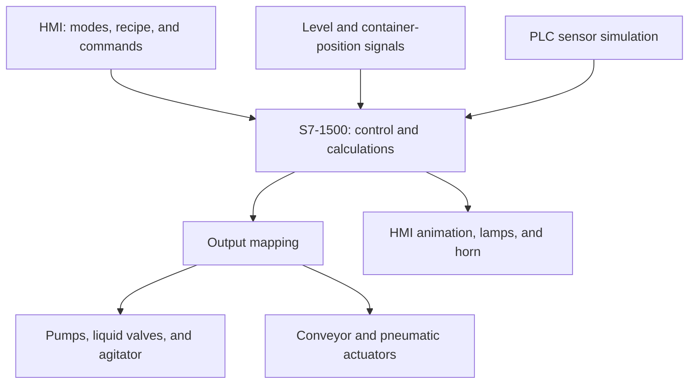

# Color Mixing & Bottle Filling Control System

This project demonstrates a simulated **color mixing, bottle filling, and capping system** controlled by a **Siemens S7-1500 PLC** and supervised through **WinCC Runtime Advanced**.

The system combines three liquid ingredients according to a selected recipe, runs an intermittent mixing cycle, fills a container, coordinates pneumatic lid handling, and washes the mixing tank before the next batch.

---

## 1. System Overview

The process consists of:

- **Three ingredient reservoirs**, identified as `Red`, `Yellow`, and `Green` in the PLC tags.
- **One cleaning-water reservoir** for washing the mixing tank.
- **Four pumps and four inlet valves** for ingredient dosing and cleaning-water supply.
- **One mixing tank** with an agitator, level detection, a product outlet, and a separate wash-water outlet.
- **One conveyor** with four container-position sensors.
- **Three pneumatic actuators** for container feeding, lid feeding, and lid pressing.
- **A WinCC HMI** for mode selection, recipe settings, manual commands, and process visualization.

Two operating modes are available: **Manual** for individual actuator control and **Automatic** for the coordinated production sequence.

**Development environment:** Siemens S7-1500, TIA Portal V21, Ladder Logic (LAD), WinCC Runtime Advanced V17, and S7-PLCSIM V21. The project includes PLC-based sensor simulation and container-position values for HMI animation.

---

## 2. Operating Modes

### 2.1 Manual Mode

Manual mode allows the operator to control individual devices through dedicated commands:

- Start or stop each of the **four pumps**.
- Open or close the **six liquid valves**.
- Operate the **three pneumatic valves**.
- Start or stop the **agitator** and **conveyor**.

These commands are processed in `FC_MANUAL` and routed to the outputs through `FC_OUTPUT`. Manual mode supports individual function checks and simulation of actuator operation without running the complete automatic sequence.

**Recipe entry and manual actuation are separate functions.** The original requirements describe entering custom ingredient ratios and then running the production cycle. In the supplied PLC implementation, those ratios are recipe setpoints for Auto operation, while Manual mode provides direct actuator control. Auto start permissives and sequence fault gating belong to the automatic control path.

---

### 2.2 Auto Mode

In Automatic mode, the PLC coordinates ingredient dosing, mixing, container handling, filling, capping, tank washing, and batch repetition.

#### Recipe and Dosing Logic

1. Select a color recipe or enter the three ingredient ratios through the HMI.
2. Set the total batch quantity, conversion factor, batch count, mixing time, rest time, and repetition counts.
3. Press **Start** after the supply-level and process-setting permissives are satisfied.
4. The three ingredient pumps and their corresponding inlet valves start together.
5. Each channel stops independently when its accumulated value reaches its calculated target.

`FC_CAL` calculates each ingredient target as:

**Ingredient target = Total quantity × Conversion factor × Ingredient ratio**

The dosing model accumulates progress using a **100 ms pulse** while each automatic ingredient-pump command is active. The startup recipe fractions are **0.5 Red, 0.3 Yellow, and 0.2 Green**.

#### Mixing and Filling

- After all three ingredient channels finish dosing, the agitator alternates between **mixing** and **resting**.
- The startup settings are **3 seconds ON**, **3 seconds OFF**, repeated **5 times**.
- In parallel with ingredient dosing, the container-feeding actuator introduces a container onto the conveyor.
- The conveyor positions the container at the filling station using proximity-sensor feedback.
- When mixing is complete and a container is detected at the filling position, the product outlet opens.
- After the mixing-tank low-level signal falls, a **10-second discharge delay** elapses before the product valve closes.

#### Capping and Tank Washing

- After filling, the container is transferred toward the capping station.
- A timed pneumatic sequence controls lid feeding and lid pressing, followed by transfer toward the discharge sensor.
- The cleaning-water pump and inlet valve fill the mixing tank until the high-level signal is reached.
- The agitator performs the wash sequence using the configured mixing and rest times. The startup wash repetition count is **3**.
- The wash-water outlet drains the tank. Its closing sequence also uses a **10-second delay** after the low-level signal falls.
- Batch repetition waits for both the **tank-cleaning completion** and **container-handling completion** flags.

The values above describe the supplied PLC export. They include changes from the original written requirements, such as the 10-second discharge delays and the implemented capping timers.

#### Start Permissives and Fault Response

- Supply-level signals are checked before the automatic process is enabled.
- Batch quantity, conversion factor, and timing/repetition settings must satisfy the configured positive-value checks, with at least one positive ingredient ratio.
- A detected source-tank low-level condition latches the **fault lamp** and **horn**.
- The fault state inhibits automatic output commands and gates automatic sequence execution.
- After correcting the condition, use **Stop** to acknowledge/reset the latched state and automatic sequence before starting another cycle.

---

## 3. Control Logic Summary

| **Program Block** | **Responsibility** |
| --- | --- |
| `Main [OB1]` | Cyclic block calls, mode selection, 100 ms pulse generation, stop handling, and container-animation updates. |
| `Startup [OB100]` | Initializes recipe fractions, batch settings, mixing/rest times, and repetition counts. |
| `FC_OUTPUT [FC1]` | Maps the selected Manual or Auto commands to actuator outputs; applies fault gating to the Auto path. |
| `FC_MANUAL [FC2]` | Processes individual pump, valve, agitator, and conveyor commands. |
| `FC_AUTO [FC3]` | Executes production, washing, container handling, batch repetition, and automatic fault handling. |
| `FC_FIELD_SIGNAL [FC4]` | Copies field-input data into the internal signal area when simulation is not selected. |
| `FC_CAL [FC5]` | Calculates ingredient targets and updates automatic dosing accumulators. |
| `FC_SIMULATION [FC6]` | Generates internal level and proximity-sensor signals using timers. |
| `FC_SIMU_BOTTLE_CD [FC7]` | Updates container-position flags and the position value used for HMI animation. |

- Internal command bits separate operator requests and sequence states from physical output assignments.
- Mixing-tank operation and container handling use coordinated step sequences.
- Simulation mode provides internal sensor signals for testing the process without physical equipment.

---

## 4. Alarm and Indicator Summary

| **Condition** | **Action Taken** | **Indication** |
| --- | --- | --- |
| Source-tank low-level fault detected during Auto operation | Latch the fault and inhibit the automatic control path. | Fault lamp `Q_Lamp_Fault` and horn `Q_Horn`. |
| Auto start permissives not satisfied | Prevent the automatic sequence from starting. | Operating-condition permissive remains false. |
| Automatic cycle started | Activate production and container-handling sequences. | Running lamp `Q_Lamp_Running` is set; stop lamp is cleared. |
| Configured batch-completion condition reached | Set the production-complete flag. | Horn sounds and `Int_mixing_done` is set. |
| Stop requested | Reset the automatic sequence and accumulators; clear the horn, fault, and running indications. | Stop lamp `Q_Lamp_Stop` is set. |

---

## 5. Operation Sequence

1. Open the PLC/HMI project in TIA Portal and start the PLC and HMI simulation.
2. Select the project's **Simulation** option when using its internally generated sensor signals.
3. Choose **Manual** for individual actuator checks, or **Auto** for the production sequence.
4. In Auto mode, select the recipe and configure the batch quantity, ratios, timings, and repetition counts.
5. Press **Start** once the operating-condition permissives are satisfied.
6. Dose the three ingredients while the container-feeding and conveyor sequence positions a container for filling.
7. Run the intermittent mixing sequence, then discharge the mixture into the positioned container.
8. Transfer the filled container through the pneumatic capping sequence while the tank-washing sequence proceeds.
9. Wait for both container discharge and tank cleaning to finish before repeating the process.
10. Monitor the batch-completion indication. If a fault occurs, correct the condition and reset with **Stop** before restarting.

---

## 6. System Benefits

- **Configurable recipes** using ingredient ratios, batch quantity, and conversion settings.
- **Coordinated production stages** covering dosing, mixing, filling, capping, and washing.
- **Parallel process handling** for mixing-tank operation and container transport.
- **Separate Manual and Auto control paths** for individual function checks and automatic sequencing.
- **Modular PLC organization** with dedicated calculation, output, field-signal, and simulation functions.
- **PLC/HMI simulation** for studying sequence behavior, sensor transitions, and container animation.
---

## Author

**Minh Nhat Nguyen**  
Automation Engineering Student — Seinäjoki, Finland  
📧 [nhat.nguyen@seamk.fi](mailto:nhat.nguyen@seamk.fi)  
🔗 [GitHub](https://github.com/nhat0508) | [Portfolio](https://nhatnguyenportfolioweb.vercel.app/)
